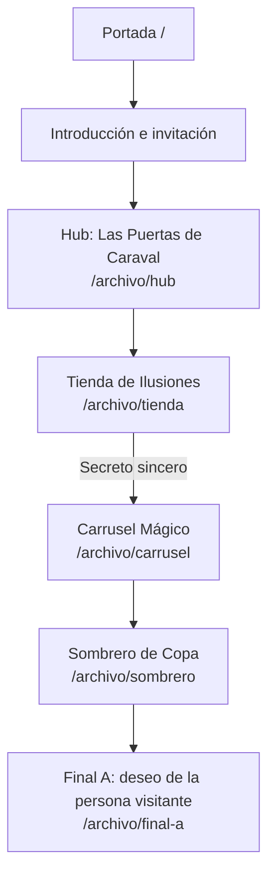

# Caraval: La Isla de los Sueños

Experiencia web transmedia interactiva desarrollada para **Programación III — UMAI**.

> **Deploy público:** [threejs-experimental.vercel.app](https://threejs-experimental.vercel.app)

## Concepto y sinopsis

### Concepto

El proyecto es una adaptación académica y no oficial inspirada en el universo de *Caraval*, de Stephanie Garber.

Eres un invitado distinguido en la mística y peligrosa feria de Caraval. Tu cometido es adentrarte en la Isla de los Sueños, explorar escenarios 3D abstractos y recolectar los fragmentos de las pertenencias de **Legend** para descifrar su verdadera identidad y ubicación. Si demuestras la astucia necesaria para hallarlo antes de que la feria extinga sus luces, podrás enfrentarlo en el Balcón del Castillo y reclamar un deseo mágico, recordando siempre su única y sagrada advertencia:  
> *"Recuerda, es solo un juego..."*

### Sinopsis

La experiencia comienza con una carta que invita a cruzar las fronteras de Caraval, la Isla de los Sueños. Después de atravesar el portal de entrada, la persona usuaria recorre una tienda de ilusiones, un carrusel mágico, un sombrero de copa y los túneles subterráneos de la feria. Cada objeto encontrado —una rosa, una máscara, un reloj, cartas, una llave y otros artefactos— aporta una pieza de la identidad que se intenta reconstruir.

Las decisiones modifican el recorrido: pagar con un secreto sincero conduce a una ruta de descubrimiento, mientras que pagar con un aurio abre un camino más incierto. La experiencia culmina con distintos desenlaces posibles y, en el final principal, la posibilidad de escribir un deseo para entregárselo a Legend.

## Cómo recorrer la experiencia

1. En la portada, mantené presionado el mouse y dibujá un círculo para revelar el acceso.
2. Abrí la invitación y elegí entrar a Caraval.
3. Explorá los objetos 3D y seguí las instrucciones de cada escena.
4. Resolvé los acertijos y completá las interacciones para obtener fragmentos.
5. Usá los controles de audio y de navegación disponibles cuando sea necesario.

La interacción 3D se acompaña con instrucciones textuales, formularios y botones para que el recorrido no dependa exclusivamente del mouse o del canvas.

## Referencias visuales y narrativas

### Referencias narrativas

- El universo de *Caraval*, de Stephanie Garber: la feria como espacio de juego, ilusión, deseo y ambigüedad.
- La figura de Legend como maestro de ceremonias y presencia difícil de distinguir de sus propias ilusiones.
- La estructura de búsqueda: una invitación inicial, objetos-pista, acertijos, decisiones y finales alternativos.
- La idea del deseo como recompensa y como elemento narrativo que conecta a la persona visitante con el mundo ficticio.

### Referencias visuales

- Ferias nocturnas, circos fantásticos y espacios de espectáculo.
- Estética barroca y veneciana: máscaras, cartas, sellos de cera, relojes y objetos ornamentales.
- Contraste entre fondos negros/azul profundo y brillos blancos o plateados para sugerir magia y misterio.
- Texturas de papel, cartas e invitaciones como puerta de entrada al relato.
- Escenarios 3D con partículas, halos, niebla, shaders luminosos y transiciones cinematográficas.

## Mapa del recorrido y navegación



### Rutas principales

| Ruta | Escena | Interacción principal |
| --- | --- | --- |
| `/` | Portada | Dibujar un círculo para revelar el botón de inicio |
| `/archivo/hub` | Las Puertas de Caraval | Mantener presionado el arco para despertar el portal y revelar la rosa |
| `/archivo/tienda` | La Tienda de Ilusiones | Encontrar la máscara y elegir cómo pagar |
| `/archivo/carrusel` | El Carrusel Mágico | Encontrar siete cartas y ordenarlas de menor a mayor |
| `/archivo/sombrero` | El Sombrero de Copa | Arrastrar el sombrero y resolver la adivinanza |
| `/archivo/final-a` | Final principal | Escribir y entregar un deseo |

`app/archivo/[chapter]/page.js` implementa la ruta dinámica que selecciona cada escena a partir del parámetro `chapter`.

## Decisiones técnicas principales

- **Next.js 16 + App Router:** las rutas representan la portada y cada capítulo de la experiencia. `app/layout.js` centraliza la metadata, las tipografías y los proveedores globales.
- **Componentización en React:** cada escena cuenta con un componente de experiencia, una escena 3D y componentes de interfaz separados.
- **Client Components donde hay interacción:** las escenas, el audio, la navegación, la autenticación y el progreso usan `"use client"` porque requieren estado, eventos del navegador o APIs como `localStorage`.
- **Three.js directo:** se eligió Three.js sin React Three Fiber para controlar explícitamente la escena, cámara, renderer, iluminación, animación, raycasting y liberación de recursos.
- **Modelos `.glb`:** `GLTFLoader` carga los objetos y escenarios 3D desde `public/models`.
- **Shaders y partículas:** se utilizan materiales GLSL, halos, niebla, destellos y sistemas de partículas para reforzar la estética mágica y las transiciones.
- **Motion:** `motion/react` gestiona entradas, salidas y revelaciones de la interfaz.
- **Audio ambiental:** cada ruta puede tener una pista propia. `AmbientMusic` realiza el cambio de pista y contempla el bloqueo de reproducción automática de los navegadores.
- **Persistencia híbrida:** el progreso se conserva en `localStorage` y, si Firebase está configurado, se sincroniza con Cloud Firestore. La aplicación puede funcionar en modo local sin credenciales.
- **Autenticación:** Firebase Authentication permite continuar como invitado mediante sesión anónima o iniciar sesión con Google y email/contraseña.
- **Seguridad:** `firestore.rules` limita los documentos de progreso y perfiles al UID autenticado y valida los deseos enviados.
- **Responsive y accesibilidad:** las escenas se adaptan al viewport, las interacciones importantes tienen instrucciones textuales y los acertijos incluyen controles de formulario y botones.

### Tecnologías

| Tecnología | Uso |
| --- | --- |
| Next.js 16.4.2 | Aplicación web y App Router |
| React 19.2.8 | Interfaz y estado |
| Three.js 0.186.1 | Escenas 3D, modelos, raycasting y shaders |
| Firebase 12.18.0 | Authentication y Cloud Firestore |
| Motion 14.9.1 | Animaciones de interfaz |
| Tailwind CSS 4 | Estilos utilitarios y responsive |

## Créditos y recursos

### Propiedad intelectual y referencias

La experiencia está inspirada en *Caraval*, de **Stephanie Garber**. Los nombres, personajes y conceptos pertenecientes a ese universo no son propiedad del proyecto. Esta implementación tiene finalidad académica y no comercial; no es un producto oficial ni está afiliada a la autora o a sus editoriales.

### Tipografías

- **Imbue**, cargada mediante `next/font/google`, para títulos y textos de display.
- **Darker Grotesque**, cargada mediante `next/font/google`, para textos de interfaz.
- Georgia, Arial y Helvetica se utilizan como fuentes de respaldo en algunos componentes y texturas.

### Modelos 3D

Los archivos se encuentran en `public/models/` y son cargados localmente por la aplicación:

- `puerta-hub-1.glb`, `moon.glb`, `wax_seal_with_plant.glb`, `letter-paper.glb`, `carousel_spinning.glb`, `cards.glb` y `balcony-v2.glb`.
- `venetian_mask_1.glb`, `top_hat__free_download.glb`, `pride_rose.glb`, `pre-islamic_silver_coin_saa022n.glb`, `pocket_watch.glb`, `magic_key.glb`, `high_poly_stylized_feather_-_free_download.glb`, `gear_clock.glb` y `deck_of_cards.glb`.

Varios GLB conservan metadata de exportación de Sketchfab, pero el repositorio no contiene los autores, URLs de las páginas de origen ni las licencias individuales. Antes de una distribución pública definitiva, se debe completar esta tabla con la atribución requerida por cada modelo. `balcony-v2.glb` contiene metadata de procesamiento con glTF-Transform.

### Imágenes y video

Los recursos visuales locales son:

- `public/imgs/home-back-1.jpeg`: fondo de portada.
- `public/imgs/home-back-video.mp4`: video de fondo de portada.
- `public/imgs/legend.jpeg`: imagen utilizada en la revelación final.
- `public/favicon.png`: favicon de la aplicación.

El repositorio no conserva información de autoría, fuente o licencia para estos archivos. Se debe agregar esa información si fueron tomados de una fuente externa o reemplazarlos por recursos propios/licenciados.

### Audio

Las pistas ambientales se encuentran en `public/audio/` y se asignan por ruta desde `data/ambientTracks.js`:

`home.mp3`, `hub.mp3`, `tienda.mp3`, `carrusel.mp3`, `sombrero.mp3` y `finalA.mp3`.

El repositorio no incluye datos de autoría o licencia de las pistas. Completar los créditos de cada archivo antes de publicar una versión comercial o redistribuible.

### Desarrollo y adaptación

- Implementación web, integración 3D, componentes, interfaz y adaptación narrativa: Victoria Villalba.
- Cátedra: Programación III — UMAI.
- Documentación complementaria de Three.js: [GUIA-THREEJS.md](./GUIA-THREEJS.md).

## Declaración de uso de inteligencia artificial

Durante el desarrollo se utilizaron herramientas de inteligencia artificial generativa como apoyo para la ideación, la organización de la documentación, la consulta técnica, la revisión de código. También fue utilizada para la optimización y organización del código. La selección de recursos, las decisiones narrativas y visuales, la integración de las escenas, las pruebas y la responsabilidad sobre el resultado final corresponden a la autora del proyecto.

## Instalación y configuración

### Requisitos

- Node.js 20 o superior.
- Yarn o npm.
- Un navegador moderno con soporte para WebGL.

### Instalación local

```bash
git clone https://github.com/vickyvillalba22/threejs-experimental.git
cd threejs-experimental
yarn install
yarn dev
```

También se puede utilizar npm:

```bash
npm install
npm run dev
```

Abrir [http://localhost:3000](http://localhost:3000).

### Firebase

Firebase es opcional para recorrer la experiencia en modo local. Para habilitar autenticación y sincronización:

1. Crear un proyecto y una aplicación web en [Firebase Console](https://console.firebase.google.com/).
2. Habilitar en Authentication los proveedores **Anonymous**, **Google** y **Email/Password**.
3. Crear una base de datos de **Cloud Firestore**.
4. Crear `.env.local` en la raíz y completar las variables indicadas abajo.
5. Publicar o revisar las reglas de [firestore.rules](./firestore.rules).
6. En Firebase, agregar `localhost` y el dominio de Vercel como dominios autorizados.
7. Reiniciar el servidor de desarrollo después de modificar las variables.

Sin configuración de Firebase, la aplicación muestra el estado **MODO LOCAL** y conserva el progreso en el navegador. Con Firebase activo, la interfaz puede mostrar una sesión anónima o una cuenta identificada y sincronizar el progreso en la nube.

### Scripts disponibles

```bash
yarn dev       # servidor de desarrollo
yarn lint      # análisis estático
yarn build     # build de producción
yarn start     # ejecutar el build de producción
```

Con npm, reemplazar `yarn` por `npm run`.

## Variables de entorno requeridas

Crear `.env.local` a partir de las credenciales de la aplicación web de Firebase. No subir este archivo al repositorio.

```env
NEXT_PUBLIC_FIREBASE_API_KEY=tu_api_key
NEXT_PUBLIC_FIREBASE_AUTH_DOMAIN=tu_proyecto.firebaseapp.com
NEXT_PUBLIC_FIREBASE_PROJECT_ID=tu_proyecto
NEXT_PUBLIC_FIREBASE_STORAGE_BUCKET=tu_proyecto.firebasestorage.app
NEXT_PUBLIC_FIREBASE_MESSAGING_SENDER_ID=tu_messaging_sender_id
NEXT_PUBLIC_FIREBASE_APP_ID=tu_app_id
```

| Variable | Obligatoria | Descripción |
| --- | --- | --- |
| `NEXT_PUBLIC_FIREBASE_API_KEY` | Para modo nube | API key de la aplicación web de Firebase |
| `NEXT_PUBLIC_FIREBASE_AUTH_DOMAIN` | Para modo nube | Dominio de Firebase Authentication |
| `NEXT_PUBLIC_FIREBASE_PROJECT_ID` | Para modo nube | ID del proyecto de Firebase |
| `NEXT_PUBLIC_FIREBASE_STORAGE_BUCKET` | Para modo nube | Bucket asociado al proyecto |
| `NEXT_PUBLIC_FIREBASE_MESSAGING_SENDER_ID` | Para modo nube | ID del sender de Firebase |
| `NEXT_PUBLIC_FIREBASE_APP_ID` | Para modo nube | ID de la aplicación web |
| `NEXT_PUBLIC_DISABLE_PROGRESS_PERSISTENCE` | Opcional | Usar `true` para desactivar la persistencia y forzar el modo local |

Las variables `NEXT_PUBLIC_` se incorporan al bundle del cliente. No colocar secretos privados en ellas; la protección de los datos depende de Authentication y de las reglas de Firestore.

## Deploy público

La experiencia está publicada en Vercel:

**[https://threejs-experimental.vercel.app](https://threejs-experimental.vercel.app)**

Para actualizarla, configurar las mismas variables de entorno en el proyecto de Vercel y volver a desplegar la rama principal.

## Estructura relevante

```text
app/
  page.js                    # portada
  layout.js                  # layout, metadata y tipografías
  archivo/[chapter]/page.js  # ruta dinámica de escenas
components/                  # escenas, UI, audio y transiciones
data/                        # capítulos, artefactos y pistas de audio
hooks/useProgress.js         # estado y persistencia del progreso
lib/firebase.js              # inicialización de Firebase
public/models/               # modelos 3D GLB
public/imgs/                 # imágenes y video
public/audio/                # pistas ambientales
firestore.rules              # reglas de acceso a Firestore
```
